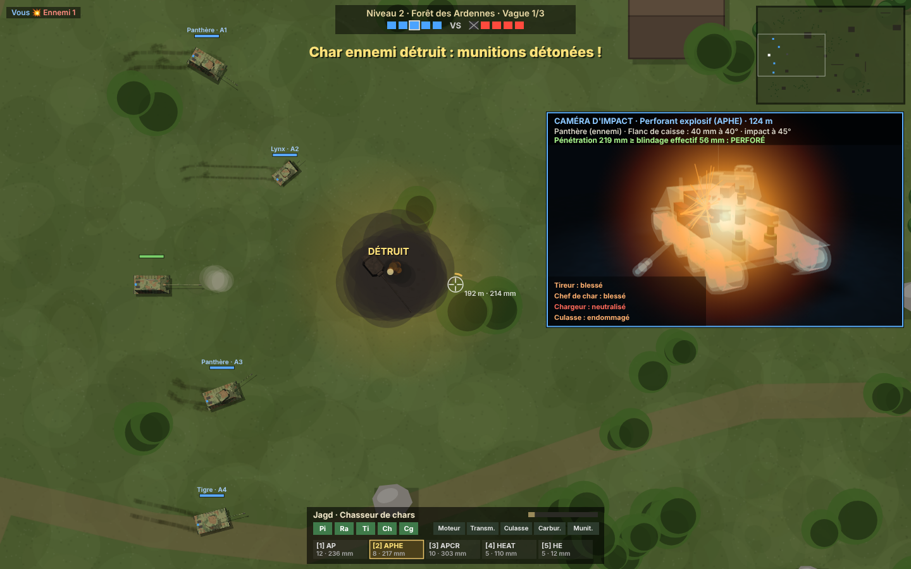

# 🪖 Front d'Acier

Combat de chars d'assaut en vue de dessus, en équipes de 5 contre 5 face à des IA. Le jeu tourne
entièrement dans le navigateur (HTML5 Canvas et WebGL), sans aucune dépendance. Les chars sont
modélisés en 3D par le code et les sons sont synthétisés en temps réel (Web Audio API).

## Lancer le jeu

Ouvrir `chars/index.html` dans un navigateur récent, au clavier et à la souris.

## Commandes

| Touche | Action |
|---|---|
| Z / S (AZERTY), W / S (QWERTY) ou ↑ / ↓ | Avancer / reculer |
| Q / D (AZERTY), A / D (QWERTY) ou ← / → | Faire pivoter la caisse |
| Souris | Viser (la tourelle tourne à sa propre vitesse) |
| Clic gauche / Espace | Tirer |
| 1 à 5 | Obus AP, APHE, APCR, HEAT, HE (changer d'obus impose de recharger) |
| E | Fumigène (2 par vague) |
| H | Activer ou couper la caméra d'impact |
| M | Couper le son |
| Échap / P | Pause |
| Clic (une fois détruit) | Changer d'allié observé |

## Déroulement

- **5 champs de bataille**, débloqués un à un : Plaine de Koursk, Forêt des Ardennes, Ruines de
  Stalingrad, Désert d'El Alamein et Nuit de Bastogne (de nuit, avec une vision réduite).
- **3 vagues par niveau.** Chaque vague est un combat 5 contre 5 : toi et 4 alliés IA contre 5 chars
  ennemis. On ne réapparaît pas pendant une vague : si tu es détruit, tu observes tes alliés.
- **4 chars**, inspirés de chars réels : Lynx (Luchs), Panthère (Panther), Tigre (Tiger I) et
  Jagd (Jagdpanther, sans tourelle, avec un secteur de tir de ±12°).

## Chars en 3D

Les modèles sont construits par le code (`models.js`) et rendus par un petit moteur WebGL
(`gl3d.js`) : plaques de blindage inclinées, galets entrelacés, chenilles, jupes, frein de bouche,
tourelleau, échappements. Le camouflage trois tons, la boue, les salissures et les éclats de
peinture sont procéduraux. Dans le menu, la vitrine tourne autour du char choisi (à la souris ou au
doigt), et le bouton **Rayons X** montre l'emplacement de l'équipage, du moteur, des munitions, de la
culasse et des réservoirs. En jeu, les chars vus de dessus sont rendus à partir des mêmes modèles.

## Obus

| Obus | Effet |
|---|---|
| AP, perforant | Obus plein, éclats modérés |
| APHE, perforant explosif | Explose 1,2 m après avoir percé (si le blindage fait au moins 15 mm) : énormes dégâts internes |
| APCR, sous-calibré | Très forte pénétration et très rapide, mais elle chute vite avec la distance ; peu d'éclats, ricoche plus facilement |
| HEAT, charge creuse | Pénétration constante quelle que soit la distance, obus lent, arrêté en partie par les jupes |
| HE, explosif | Faible pénétration, mais casse les chenilles et blesse l'équipage des chars à toit mince ; souffle qui touche tout le monde |

Le réticule affiche la distance et la pénétration de l'obus chargé à cette distance.

## Modèle de dégâts

- **Pas de points de vie.** Chaque char a des modules internes : équipage (pilote, radio, tireur, chef,
  chargeur), moteur, transmission, culasse, réservoirs, soutes à munitions.
- **Hauteur d'impact** : un obus touche le haut ou le bas de la caisse, la tourelle ou le masque du
  canon, ou bien passe au-dessus.
- **Blindage incliné en 3D** : épaisseur / cos(angle d'impact), avec des valeurs réelles approximatives
  (par exemple, l'avant du Panther fait 80 mm à 55°). Au-delà de l'angle limite, l'obus ricoche et peut
  toucher un autre char. Un calibre plus de trois fois supérieur au blindage ne ricoche pas.
- **Après une perforation**, l'obus et ses éclats sont tracés en 3D à travers les modules.
  - Un équipier tué fait perdre son poste. Un camarade le remplace au bout de 5 s.
  - Un moteur ou une transmission détruits immobilisent le char. La culasse empêche de tirer.
  - Les chargeurs ralentissent le rechargement.
  - Les réservoirs peuvent prendre feu. Une soute peut exploser et arracher la tourelle.
  - L'équipage répare le moteur, la transmission, la culasse et les chenilles.
- Un char est détruit quand ses munitions explosent ou quand il lui reste moins de deux équipiers.
- **Les tirs alliés blessent** : tes obus, ceux des alliés, les ricochets et le souffle des explosifs
  touchent tout le monde.

## Caméra d'impact

Quand ton obus touche un char, le jeu passe au ralenti et une vue 3D en rayons X montre la scène :
l'obus arrive, perce (ou ricoche, ou rebondit), la charge explose, les éclats se dispersent, puis les
modules touchés changent de couleur. Un bilan s'affiche (plaque touchée, angle, blindage effectif,
pénétration, équipiers et modules touchés). La touche H la désactive.

## Autres éléments de réalisme

- **Les obus ont une vitesse finie** et laissent une traînée lumineuse : on les voit arriver. Un obus qui
  va te toucher est signalé par une trajectoire en pointillés rouges, avec son point d'impact. S'il vient
  de hors de l'écran, une flèche rouge l'indique au bord. Un obus qui te frôle siffle.
- **Dispersion** : elle grandit quand le char roule, pivote ou tourne sa tourelle, puis se resserre à
  l'arrêt (c'est le cercle du réticule).
- **Repérage** : un ennemi n'est visible que si un char de ton équipe le voit. Les bâtiments, les arbres,
  la fumée et la nuit bloquent la vue. Les buissons camouflent, mais tirer te révèle.
- **Décor destructible** : les arbres sont abattus par les obus ou écrasés au passage, et les bâtiments
  s'effondrent en gravats franchissables.

## Interface

La mini-carte est en haut à droite et le fil des destructions en haut à gauche. Le journal des dégâts
subis est en bas à gauche. En bas au centre, le panneau du char montre l'état de l'équipage, des modules,
des obus et du rechargement.

## IA

Les chars IA cherchent leur chemin sur une grille (A\*). Ils restent à la distance qui convient à leur
classe et inclinent leur blindage face à l'ennemi. Ils choisissent leur obus selon le blindage de leur
cible, anticipent son mouvement et esquivent les obus. Ils évitent de tirer quand un allié est dans la
ligne de tir (sauf les plus maladroits). Gravement touchés, ils se replient sous un fumigène. Leur
précision, leurs réflexes et leur capacité à esquiver dépendent du niveau.

## Développement

Paramètres d'URL : `?level=3&wave=2&type=heavy` lance directement une vague. `?auto` confie ton char
à l'IA, `?god` rend ton char invulnérable, `?speed=8` accélère la simulation et `?debug` expose
`window.__fa`. Sans WebGL, le jeu se rabat sur un dessin vectoriel simple.
