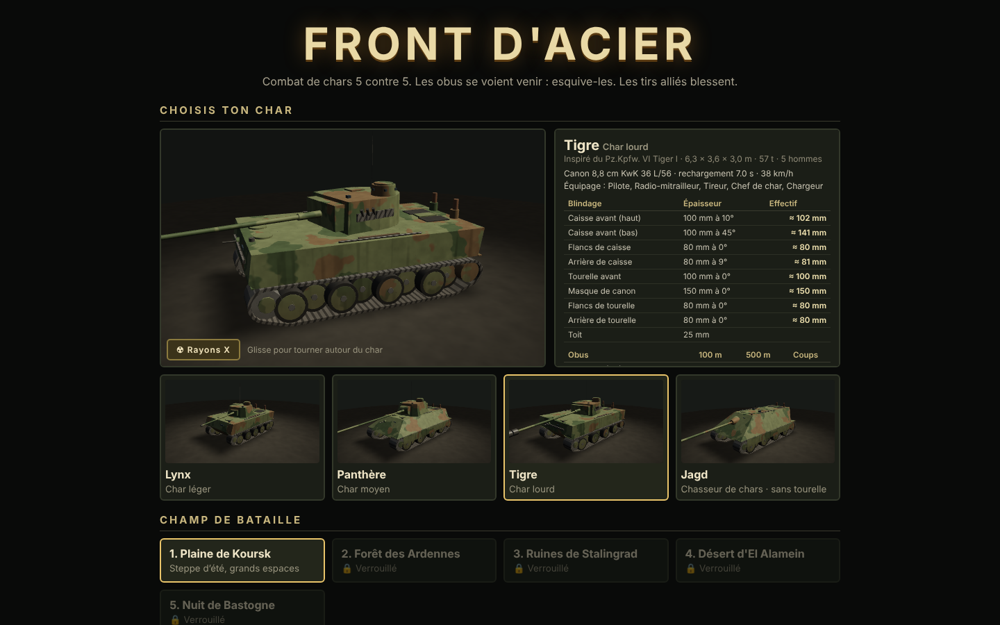
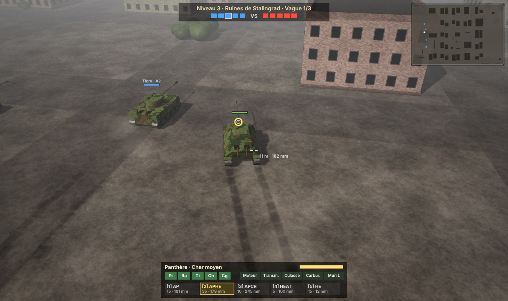
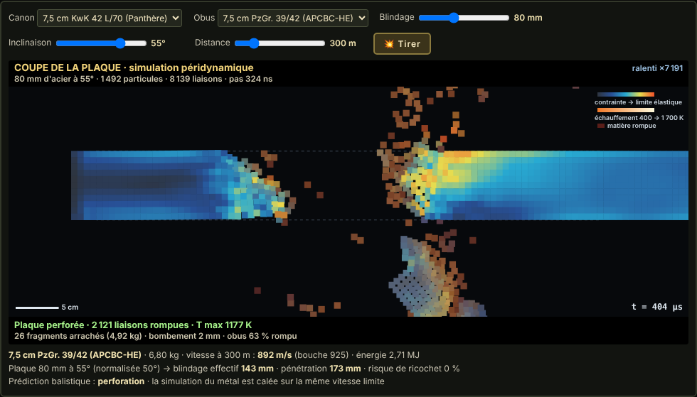
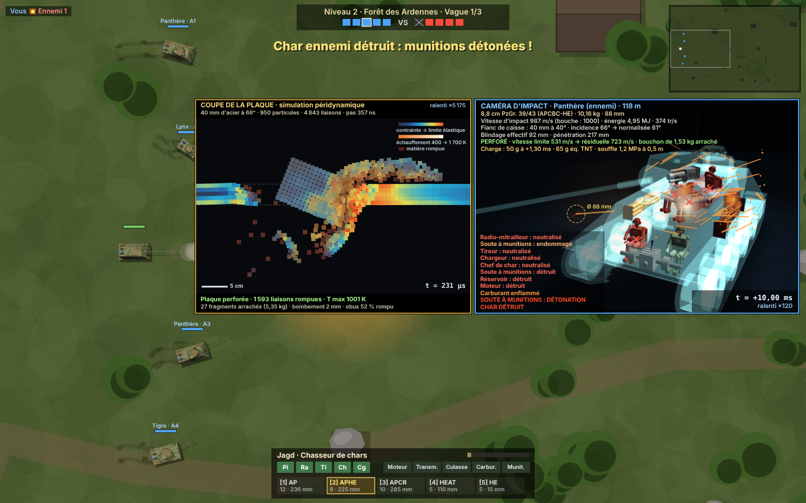
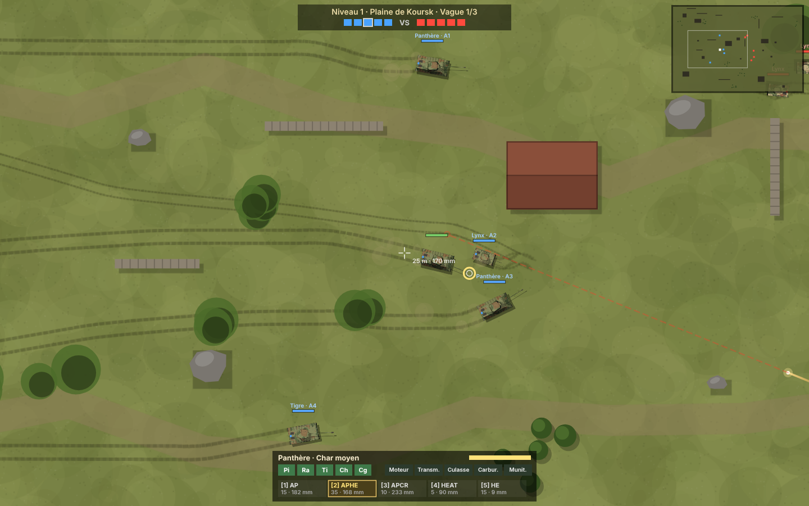

# 🪖 Steel Front

*Tank Warfare · 1943 – 1945* (anciennement *Front d'Acier*). L'interface du jeu est en anglais ;
la documentation et le code restent commentés en français.

Combat de chars d'assaut en 3D, en équipes de 5 contre 5 face à des IA. Le jeu tourne
entièrement dans le navigateur (HTML5 Canvas et WebGL), sans aucune dépendance. Les chars sont
modélisés en 3D par le code et les sons sont synthétisés en temps réel (Web Audio API).

## Lancer le jeu

Ouvrir `chars/index.html` dans un navigateur récent, au clavier et à la souris.
Le fichier `chars/steel-front.html` contient tout le jeu en un seul fichier, à ouvrir directement.

## Commandes

| Touche | Action |
|---|---|
| Z / S (AZERTY), W / S (QWERTY) ou ↑ / ↓ | Avancer / reculer |
| Q / D (AZERTY), A / D (QWERTY) ou ← / → | Faire pivoter la caisse |
| Souris | Viser (la tourelle tourne à sa propre vitesse) |
| Clic gauche / Espace | Tirer |
| 1 à 5 | Obus AP, APHE, APCR, HEAT, HE (changer d'obus impose de recharger) |
| E | Fumigène (2 par vague) |
| H | Activer ou couper la caméra d'impact |
| M | Couper le son |
| Échap / P | Pause |
| Clic (une fois détruit) | Changer d'allié observé |

## Déroulement

- **5 champs de bataille**, débloqués un à un : Plaine de Koursk, Forêt des Ardennes, Ruines de
  Stalingrad, Désert d'El Alamein et Nuit de Bastogne (de nuit, avec une vision réduite).
- **3 vagues par niveau.** Chaque vague est un combat 5 contre 5 : toi et 4 alliés IA contre 5 chars
  ennemis. On ne réapparaît pas pendant une vague : si tu es détruit, tu observes tes alliés.
- **4 chars**, inspirés de chars réels : Lynx (Luchs), Panthère (Panther), Tigre (Tiger I) et
  Jagd (Jagdpanther, sans tourelle, avec un secteur de tir de ±12°).

## Modes de jeu

- **Campagne** : 5 contre 5, trois vagues par champ de bataille ; chaque secteur conquis ouvre le suivant.
- **Survie** : seul contre des vagues de plus en plus nombreuses (jusqu'à 5 chars), lourdes et habiles.
  Elles arrivent du côté opposé au joueur. Entre deux vagues, 8 s de répit : munitions complétées de
  moitié, modules réparés, fumigène rendu ; les équipiers tués ne reviennent pas. Le record est gardé.
- **Duel** : 1 contre 1 à chars identiques, en 3 manches gagnantes, contre une IA d'élite.

## Balistique en 3D

Les obus et les balles volent en vraie 3D, avec la pesanteur et la traînée de l'air.

- **Visée en hauteur** : en vue extérieure, le rayon de la souris touche le premier objet en 3D (caisse,
  tourelle, obstacle à sa hauteur, ou sol). On vise donc le haut ou le bas d'un char ; l'indicateur près
  du réticule donne la plaque, le blindage effectif et le verdict.
- **Chute** : la pente de la trajectoire diminue de g/v² par mètre. Le canon prend la surélévation qui
  compense la chute jusqu'au point visé (débattement de −8° à +20°) ; la dispersion est la même en
  hauteur et en largeur.
- **Obstacles en hauteur** : un muret de 1,3 m cache la caisse mais pas la tourelle. On voit et on tire
  par-dessus : c'est le « hull-down », caisse à couvert, tourelle seule exposée. Rochers à leur hauteur,
  maisons et arbres plus hauts que tout tir.
- **Ricochets** : sur une plaque inclinée, la direction 3D se réfléchit sur la normale, donc l'obus part
  vers le haut. Un obus perforant qui touche le sol sous moins de 7° rebondit (ricochet de sol). Les
  rayons X montrent l'angle de chute et la hauteur d'impact.
- **Mitrailleuse coaxiale** (touche `F`, ou clic droit à la lunette) : type MG 34, 7,92 mm à 755 m/s,
  environ 900 coups/min, une traçante sur cinq. Le canon chauffe : au-delà de 250 coups d'affilée, il
  faut 7 s pour le changer. Sans effet sur un blindage de char, mais les traçantes qui frappent l'acier
  repartent en chandelle. L'IA lâche des rafales courtes sur ses cibles.

## La mitrailleuse au combat

Une balle de 7,92 mm ne perce pas un char, sauf en des points précis, comme dans la réalité.

- **Munitions** (touche `G`) : S.m.K. à noyau d'acier (11 mm perforés à 100 m, incidence nulle) et
  S.m.K.H. à noyau de carbure de tungstène (15 mm à 100 m, 150 coups seulement). La perforation baisse
  avec la distance ; au-delà de 70° d'incidence, la balle ricoche.
- **Chef de char à découvert** : les chefs de l'IA se tiennent debout dans la coupole (ou à la trappe
  du chasseur), ce qui leur donne 15 % de vue en plus. Leur tête et leur buste dépassent du blindage :
  une rafale peut les blesser ou les tuer. Le joueur peut sortir le sien avec `U`.
- **Feu de neutralisation** : dès que des balles claquent autour d'eux, les chefs rentrent et ferment.
  Ils ne ressortent qu'après 12 s de calme. Tourelle fermée, l'équipage voit moins bien.
- **Points faibles optiques** : visière du pilote (vitesse −30 %), viseur du tireur à côté du canon
  (dispersion × 2,5), épiscopes de la coupole (vue réduite tourelle fermée). Il faut 15 s pour les
  remplacer.
- **Tôles minces** : la plaque arrière du char léger (15 mm à 12°) cède aux S.m.K.H. à courte portée.
  La balle touche alors le premier module sur sa trajectoire : un équipier est blessé ou tué.
- **Rayons X** : quand une balle du joueur fait quelque chose (chef touché, optique brisée,
  perforation), la caméra d'impact montre la balle, sa vitesse, son énergie et sa perforation à cette
  distance, le point faible touché, et le chef debout dans sa coupole.

## Blindage marqué par les impacts

Chaque coup laisse une trace qui reste sur le char et affaiblit la plaque autour du point touché.

- **Obus arrêté** : cratère d'acier mis à nu, apprêt rouge visible autour, zone écrouie. La plaque y
  perd jusqu'à 45 % de sa résistance sur environ 1,5 calibre. S'il a failli percer (rapport
  perforation / blindage au-delà de 0,8), elle se fissure plus loin.
- **Perforation** : trou du calibre, bord déchiqueté, suie. Un coup qui retombe dans le trou ne
  rencontre presque plus rien ; autour, l'acier fissuré perd 35 %.
- **Ricochet** : saignée allongée dans le sens du coup.
- **Explosif et charge creuse** : suie et piqûres ; sur une tôle mince, plaque et soudures fissurées.
- **Balles** : écaillage de la peinture. Presque rien sur l'acier, mais les coups s'accumulent au même
  endroit.
- Les pertes se somment (gaussienne autour de chaque impact), plafonnées à 80 %. Les rayons X
  indiquent l'épaisseur utile restante et la distance à l'impact précédent, et marquent les anciens
  impacts sur la caisse.
- Les traces sont collées à la vraie surface du modèle, trouvée par un rayon contre ses triangles
  (Möller-Trumbore). Elles restent sur les épaves.

## Modèles 3D

Chaque char est construit d'après ses plans, avec ce qui le distingue :

- **Lynx (Pz. II L)** : cinq grandes roues entrelacées sans galets supérieurs, tourelle à épiscopes,
  lance-pots fumigènes.
- **Panzer IV H** : huit petites roues sur quatre bogies à ressorts à lames, quatre galets supérieurs,
  jupes de 5 mm sur rails bien écartées des chenilles, jupes de tourelle ouvertes à l'avant, portes
  latérales de tourelle, coffre arrière, silencieux transversal, maillons de rechange sur le nez.
- **Panthère** : roues entrelacées, glacis et flancs inclinés, rotule de mitrailleuse de caisse,
  coupole à sept épiscopes, trappe d'évacuation ronde à l'arrière de la tourelle, bouchons de
  meurtrières, douilles de grue (« Pilze »), deux ventilateurs ronds sur le moteur, pare-flammes,
  coffres de paquetage.
- **Tigre** : caisse en caisson à flancs verticaux, roues entrelacées, tourelle en fer à cheval avec son
  coffre, lance-pots fumigènes, maillons de rechange, lance-mines S aux coins du toit, grilles
  d'admission d'air, hauts échappements.
- **Tigre royal** : glacis à 50°, masque coulé en cloche (« Saukopf »), roues chevauchantes, longue
  tourelle à flancs inclinés, trappe arrière, ventilateurs.
- **StuG III G** : casemate basse, coupole du chef avec périscope en ciseaux, bouclier rabattable de la
  MG 34 du chargeur, jupes sur rails, silencieux.
- **Jagd (Jagdpanther)** : superstructure fondue dans la caisse, masque en cloche, ventilateurs.

Pour tous : relief du Zimmerit (pâte antimagnétique striée de 1943-1944, en relief dans le shader et
atténué au loin contre le moiré), boulons des roues, phare Bosch, feu Notek, crochets de remorquage,
pelle, hache, extincteur, cric, embrasures de la mitrailleuse coaxiale et du viseur, trappe ouverte de
la coupole.

## Chars et munitions

Sept chars : Lynx (Pz. II L), Panzer IV H, Panthère, Tigre, Tigre royal, StuG III G et Jagd
(Jagdpanther), avec leurs dimensions, blindages, canons et munitions d'époque. Le Tigre royal range
des obus dans la nuque de sa tourelle. Les nouveaux chars entrent dans les vagues de la campagne et de
la survie.

Deux munitions s'ajoutent (touches `6` et `7`) :

- **Obus fumigène** (Nebelgranate) : rideau de fumée au point d'impact, qui coupe la vue de l'ennemi.
- **Boîte à mitraille** (Kartätsche) : une gerbe d'une centaine de billes d'acier de 18 mm, ouverte
  d'environ 3° et vite freinée. Elle ne fait rien à l'acier, mais balaie les chefs de char à découvert
  et brise les optiques.

## Animations

- **Suspension à barres de torsion** : ressort amorti (environ 1,2 Hz, amortissement 0,3) en tangage
  et en roulis. La caisse s'accroupit à l'accélération, plonge au freinage, se couche dans les virages,
  encaisse les bosses.
- **Recul et coups reçus** : impulsion = quantité de mouvement × bras de levier / inertie de la caisse
  (masse réelle du char).
- **Canon** : séparé de la tourelle et monté sur ses tourillons. Il prend l'élévation qui amène l'obus
  sur le point visé, chute comprise, à 8,6°/s ; c'est cette élévation réelle qui fixe le départ de
  l'obus. Il recule d'une longueur réaliste (0,3 à 0,6 m selon le calibre) en 0,05 s, puis revient
  en batterie.

## Conduite et physique des chars

- **Puissance et terrain** : effort moteur = puissance utile (rendement de transmission 0,6) / vitesse,
  limité par l'adhérence (0,5 g), contre la résistance au roulement du sol (herbe 0,06, gravats 0,07,
  sable 0,08, boue 0,085, neige 0,09). La vitesse de pointe dépend donc du terrain et du rapport
  poids / puissance : sur herbe, environ 43 km/h pour la Panthère et 28 km/h pour le Tigre royal ;
  dans la boue de l'Ardenne, 30 et 20 km/h. Freinage des chenilles : 0,6 g.
- **Virages** : les chenilles ripent ; plus le sol colle, plus le pivot est lent.
- **Chenille cassée** : le char ne peut plus que pivoter autour d'elle, entraîné par la chenille
  intacte. Les roues du côté cassé s'arrêtent.
- **Collisions** : les masses réelles comptent, le plus lourd pousse le plus léger. Le choc échange
  la quantité de mouvement (restitution 0,1) et fait basculer les caisses. Au-delà de 4 m/s, le plus
  léger peut déchausser une chenille.
- **Obstacles** : un arbre se couche si la quantité de mouvement dépasse 30 t·m/s (un Tigre royal au
  pas, un Lynx lancé) ; un muret cède au-delà de 140 t·m/s.
- **Roues porteuses** : chacune tourne selon le chemin de sa chenille (v ± ω·W/2) et débat sur les
  bosses.
- **Râtelier** : les premiers obus (6 à 10 selon le char) sont dans la tourelle. Ensuite le chargeur
  va les chercher dans les soutes de caisse, avec un rechargement 45 % plus long. Hors du tir, il
  regarnit le râtelier à raison d'un obus toutes les 8 s.
- **Repérage** : un char qui roule à plus de mi-vitesse soulève un panache de poussière ; on le voit
  20 % plus loin, sauf de nuit ou sur la neige.
- **Détails** : fumée de poudre qui s'échappe de la bouche après le coup ; fumée grise d'un moteur
  touché ; traçant éteint après environ 2 km.
- **Son** : boîte à 7 rapports (le régime monte puis retombe à chaque passage), cliquetis des
  chenilles au rythme des maillons sur le barbotin, bourdonnement du moteur de tourelle.

## Effets physiques

Chaque particule a une position en 3D, des vitesses en m/s, la pesanteur, la traînée de l'air, le vent,
un rebond au sol, et une poussée vers le haut pour les gaz chauds.

- **Départ du coup** : boule de feu en bouche, jets latéraux du frein de bouche, fumée de poudre, anneau
  de poussière soulevé par l'onde de souffle sous le canon.
- **Obus explosif** : boule de feu brève, onde de choc rasante qui chasse la poussière, éclats
  incandescents, mottes projetées en hauteur, colonne de fumée brune qui monte et dérive.
- **Coup au sol** : gerbe de mottes projetées vers l'avant, colonne de poussière ; couleur du sol du
  niveau (neige, sable, gravats).
- **Coup sur blindage** : gerbe d'étincelles qui rebondissent au sol, poussière de peinture. Après une
  perforation, de la fumée ressort des écoutilles ; une charge creuse laisse une boule de fumée noire.
- **Char en feu** : flammes sur le compartiment moteur, colonne de fumée noire qui monte, s'étale et
  dérive avec le vent, puis grisaille. Dans l'épave, les munitions détonent une à une.
- **Roulage** : poussière des chenilles (moins dense sur la neige ou en forêt), gaz d'échappement à
  l'accélération.

## Vue du tireur

`Maj` (ou `V`) passe à la lunette du tireur, coaxiale au canon. La souris oriente la visée (curseur
verrouillé), la tourelle suit à sa vraie vitesse de rotation : le cercle montre où pointe réellement le
canon, avec la dispersion et le rechargement. La molette change le grossissement (×2,5, ×5, ×8).

- **Curseur incrusté** : un cercle blanc montre le point que désigne la souris, avec la distance et la
  pénétration ; son point central prend la couleur du verdict. La vue le suit en douceur (curseur
  verrouillé) ; sans verrouillage, on vise librement et la vue ne pivote qu'en approchant du bord.

- **Réticule** inspiré de la TZF allemande : triangle central, triangles tous les 4 millièmes pour la
  correction sur cible mobile, réglette des distances en hectomètres avec le curseur du télémètre. Les
  traits sont à l'échelle angulaire réelle, donc grossissent avec le zoom. Réticule éclairé la nuit.
- **Visée en hauteur** : l'obus suit la ligne de visée (hausse réglée par le télémètre). On choisit donc la plaque : haut ou bas de
  caisse, masque, tourelle. Viser trop haut fait passer l'obus au-dessus d'un char bas, trop bas le
  fiche dans le sol.
- **Indicateur** : char visé, plaque, épaisseur et inclinaison, blindage effectif, pénétration à cette
  distance, et verdict (perce, incertain, ne perce pas, ricochet probable, allié).
- **Sans stabilisateur**, comme tous les chars de l'époque : l'image tremble quand le char roule ou
  pivote, et saute au départ du coup.

## Publication sur CrazyGames

Le jeu est prêt pour CrazyGames : téléverser le contenu du dossier `chars/` (ou l'archive
`chars/dist/steel-front-crazygames.zip`) comme jeu HTML5, `index.html` à la racine.

- **SDK CrazyGames v3** (`meta.js`) : `loadingStart` / `loadingStop` autour du chargement,
  `gameplayStart` / `gameplayStop` en début et fin de bataille, en pause et pendant les publicités,
  `happytime` aux promotions et aux gros lots de la roue. La sauvegarde passe par `SDK.data`
  (et `localStorage` en secours).
- **Publicités** : une publicité de mi-partie au plus toutes les 3 minutes, seulement entre deux
  batailles (jamais pendant le jeu ni avant la première partie). Publicités récompensées, toujours
  optionnelles : réparer son char détruit, doubler les gains d'une bataille, tirage bonus de la roue,
  camouflages *Night Operation* et *Grand Parade*, pièces. Le son est coupé pendant les publicités. Hors de CrazyGames
  (fichier local, page intégrée), elles sont simulées par un écran de 3 s.
- **Progression** :
  - crédits et expérience à chaque bataille ; 16 grades, de *Private* à *Field Marshal*, avec 500 crédits par
    promotion ;
  - chars à acheter, avec un grade minimal (le Lynx et le Panzer IV sont offerts) ;
  - roue quotidienne : crédits, kits de réparation, gains × 2, camouflages ;
  - 3 missions du jour ;
  - prime de présence sur 7 jours ;
  - kits de réparation.
- **Pièces** (garage, par char, trois niveaux *Mk I* à *Mk III*) : *Maybach Tuning Kit* (+8 % de puissance),
  *Select-Lot Ammunition* (+4 % de perforation), *Field Armor Kit* (+6 % d'épaisseur ; maillons de chenille
  visibles sur le glacis, puis sur les flancs, puis sur la tourelle), *Grip Tracks* (+6 % d'adhérence),
  *Zeiss Optics* (+6 % de vue, −6 % de dispersion), *Veteran Loader* (−5 % de rechargement, +1 obus au
  râtelier). Chaque niveau
  s'achète en crédits ou s'installe en regardant niveau + 1 publicités.
- **Camouflages** : 14 camouflages et 5 motifs dessinés par le shader (taches, uni, bandes ondulées,
  embuscade à pois, lavis d'hiver usé). On les essaie sur la vitrine avant de les acheter en
  crédits ou de les débloquer par une série de publicités (1 à 6 selon la rareté). Deux sont réservés
  aux publicités. Un camouflage du jour est à −50 %.
- **Boutique** : chaque contenu a une rareté (*Common*, *Rare*, *Epic*, *Legendary*) qui colore sa carte.
  Les cartes épiques et légendaires ont un reflet qui les balaie, et les légendaires un cadre doré tournant.
  L'offre du jour porte un bandeau *DEAL −50%*. Les chars verrouillés affichent leur prix et le niveau
  requis. Les boutons publicité montrent la progression par pastilles. Chaque déblocage (char,
  camouflage, pièce, lot de la roue) ouvre un écran de célébration : rayons, confettis, aperçu en 3D,
  fanfare synthétisée et `happytime`.
- **Menu** : vitrine 3D plein écran du char choisi, avec son camouflage, et onglets Battle, Garage,
  Wheel, Missions, Workshop (banc d'essai, commandes) et Options (volumes, qualité graphique, caméra
  d'impact, plein écran, remise à zéro).
- **Musique** : `music/menu.mp3`, voir `music/README.md`.

## Rendu 3D

Le champ de bataille est rendu en 3D temps réel par un moteur WebGL écrit pour le jeu (`world3d.js`).
La simulation (déplacements, balistique, dégâts, IA) reste la même. Tout est généré par le code, sans
aucune image ni modèle externe.

- **Caméra** : au-dessus et en arrière de ton char, elle suit la **tourelle** (la direction du canon)
  avec un léger retard, pas la caisse : on peut pivoter la caisse sans que la vue bouge. Un clic dans
  le jeu verrouille le curseur : la souris oriente la visée, le curseur reste sur le même point du
  terrain pendant que la vue tourne, la tourelle le rejoint et la caméra s'arrête. Sans verrouillage
  (page intégrée), un curseur décalé fait tourner tourelle et caméra tant qu'il le reste.
  Ton char reste en bas de l'écran ; le regard se porte devant lui et vers la souris, pour voir loin
  là où tu vises.
  - `C` : changer de caméra (poursuite, tactique vue de haut, rapprochée).
  - Ennemis repérés : chevron rouge au-dessus d'eux ; hors champ, une flèche au bord de l'écran
    indique leur direction et leur distance.
  - Molette : zoom.
  - Clic droit glissé : tourner la caméra. Double-clic : la recentrer.
  - La visée se fait à la souris : un rayon part de la caméra et touche le terrain là où tu pointes.
- **Lumière** :
  - soleil avec ombres portées (carte d'ombre de 2 048 px, filtrage doux) ;
  - éclairage du ciel et rebond du sol ;
  - calcul des couleurs dans un espace linéaire, puis compression des contrastes au rendu (tone mapping ACES) ;
  - jusqu'à 8 lumières dynamiques : départs de coup, explosions, obus traceurs, incendies et, la nuit,
    phares des chars alliés.
- **Atmosphère** : ciel en dégradé avec soleil, brume qui se fond dans l'horizon. Chaque carte a sa
  lumière : été, sous-bois brumeux, ciel couvert et fumées de la ville, soleil écrasant du désert, nuit
  de pleine lune sur la neige. Un léger vignettage complète l'image.
- **Décor** :
  - sol texturé où restent les traces de chenilles et les cratères, avec un relief de détail ;
  - herbe en brins, buissons ;
  - arbres feuillus ou conifères qui bougent au vent, rochers irréguliers, murets ;
  - bâtiments avec fenêtres, portes et toits (tuiles ou toits plats à acrotère), qui se fissurent puis
    s'effondrent en gravats ;
  - arbres abattus ;
  - lisière de forêt au-delà de la carte.
- **Chars** : les modèles détaillés, avec rotation de la tourelle, recul du canon, défilement des
  chenilles et camouflage par camp. Les épaves sont calcinées et les tourelles arrachées s'envolent.
- **Effets** : traceurs, fumées éclairées par le soleil, flammes, éclairs de départ, étincelles,
  poussière, fumigènes.

`?2d` dans l'adresse rétablit l'ancien rendu en vue de dessus.

## Chars en 3D

Les modèles sont construits par le code (`models.js`) et rendus par un petit moteur WebGL
(`gl3d.js`) : plaques de blindage inclinées, galets entrelacés, chenilles, jupes, frein de bouche,
tourelleau, échappements. Le camouflage trois tons, la boue, les salissures et les éclats de
peinture sont procéduraux. Dans le menu, la vitrine tourne autour du char choisi (à la souris ou au
doigt). Le bouton **Rayons X** montre l'intérieur, chaque module étant nommé :

- l'équipage : des tankistes assis à leur poste, en tenue noire avec calot et casque radio, le pilote
  aux leviers, le tireur aux volants de pointage, le chargeur un obus dans les bras, le chef à ses jumelles ;
- le moteur V12, avec ses bancs de cylindres, ses collecteurs et son volant moteur ;
- la transmission, avec ses freins de direction ;
- les réservoirs ;
- les soutes, avec les obus rangés un par un (douille en laiton, projectile perforant ou explosif) ;
- la culasse, avec ses freins de recul et son volant de pointage. En jeu, les chars vus de dessus sont rendus à partir des mêmes modèles.

## Obus et physique

Chaque char tire des munitions historiques, avec leur masse, leur calibre et leur vitesse initiale réels
(par exemple 7,5 cm PzGr. 39/42 : 6,8 kg à 925 m/s, ou 8,8 cm PzGr. 40/43 : 7,3 kg à 1 130 m/s). Toute la
balistique est dans `ballistics.js`.

| Obus | Effet |
|---|---|
| AP, perforant | Obus plein |
| APHE, perforant explosif (APCBC-HE) | Fusée retardée de 1,3 ms (si le blindage fait au moins 15 mm) : la charge détone dans le char |
| APCR, sous-calibré | Noyau en carbure de tungstène, très rapide et très perforant ; perd vite sa vitesse, ricoche plus facilement, peu d'éclats |
| HEAT, charge creuse | Jet de cuivre à environ 6 500 m/s ; perforation indépendante de la distance, perturbée par les jupes |
| HE, explosif | Faible perforation, mais détonation, onde de choc et éclats d'enveloppe |

Les lois et les modèles utilisés :

- **Traînée de l'air** : v(x) = v0·exp(−ρ·Cd·A·x / 2m). La vitesse des obus diminue avec la distance,
  en jeu comme dans les calculs.
- **Perforation** (formule de de Marre) : P ∝ v^1,43 · m^0,71 / d^1,07, calée sur les valeurs historiques
  (environ 180 mm à 100 m pour le canon du Panther, 160 mm pour celui du Tiger).
- **Obliquité** :
  - normalisation des obus coiffés (environ 5°) ;
  - épaisseur effective T / cos(θ)^n, avec n qui dépend du rapport épaisseur/calibre ;
  - ricochet probabiliste au-delà de l'angle critique ;
  - un calibre plus de trois fois supérieur au blindage ne ricoche pas (surcalibrage).
- **Après perforation** :
  - vitesse résiduelle selon Lambert-Jonas, √(V² − Vlim²) ;
  - sur une plaque mince, arrachement d'un bouchon d'acier (conservation de la quantité de mouvement) ;
  - cône d'éclats d'autant plus large que l'obus perce de justesse, avec des masses selon la loi de Mott ;
  - écaillage de la face interne même sans perforation quand il s'en faut de peu.
- **Trajet dans le char** : le noyau traverse les modules et ralentit dans chacun (épaisseur d'acier
  équivalente). Il peut ressortir de l'autre côté, ricocher sur la paroi ou s'y loger. Chaque éclat est
  suivi en 3D : son énergie (½mv²) fixe les blessures, il traverse ou s'arrête dans les modules et ricoche
  sur les parois quand l'angle est rasant.
- **Charge explosive** :
  - surpression confinée selon Kinney-Graham ;
  - rayon de l'onde de choc selon Sedov-Taylor ;
  - éclats d'enveloppe projetés à la vitesse de Gurney.
- **Charges propulsives** touchées : elles s'enflamment et peuvent faire exploser les munitions (plus
  probable si les soutes sont pleines). Le carburant touché peut aussi s'enflammer.

Le réticule affiche la distance et la pénétration de l'obus chargé à cette distance.

## Simulation de la déformation du métal

En plus de la balistique empirique, chaque impact du joueur est simulé numériquement dans
`metal.js`, par **péridynamique** (modèle à liaisons, méthode utilisée en recherche pour les impacts et
la fragmentation). La simulation est faite en coupe 2D dans le plan de l'impact.

- **Le modèle** : la plaque et l'obus sont formés de 300 à 2 300 particules, liées à leurs voisines.
  - Chaque liaison est élastique, puis parfaitement plastique au-delà de la limite élastique.
  - Elle se rompt au-delà d'un allongement critique.
  - Le travail plastique échauffe la matière (cisaillement adiabatique).
  - Les morceaux séparés interagissent par contact.
- **Les matériaux** :

  | Matériau | Rôle | Module d'Young | Limite élastique |
  |---|---|---|---|
  | Acier de blindage (RHA) | Plaque | 207 GPa | 1 GPa |
  | Acier trempé, coiffe plus tendre | Obus perforants | | |
  | Carbure de tungstène, dense et fragile | Noyau APCR | 600 GPa | |
  | Cuivre | Jet de charge creuse, étiré de 6 500 à 2 500 m/s | | |

  L'obus explosif applique une impulsion de pression de détonation sur la face avant.
- **Le reste du char** est représenté par un appui élastique, qui empêche la plaque de fléchir comme une
  feuille et qui lâche dès que la matière est arrachée.
- **Ce qui émerge sans être scripté** : cratère, bouchon cisaillé, pétales, bombement et écaillage de la
  face arrière, fissures, obus qui s'écrase, se brise ou ricoche, échauffement jusqu'à plus de 1 000 K.
- **Calcul** : plusieurs milliers de pas de 200 à 350 ns, répartis sur les images pendant la caméra
  d'impact, sans figer le jeu. La coupe s'affiche à côté de la vue aux rayons X, colorée selon la
  contrainte, la température et l'endommagement. Le bilan donne les liaisons rompues, la température
  maximale, les fragments arrachés (masse), le bombement et la part de l'obus détruite.
- **Calage** : la vitesse limite propre à la simulation a été mesurée par dichotomie (27 configurations
  d'épaisseur, de calibre et d'angle), puis ajustée par une loi V_lim = A · (T/d)^b / cos(θ)^c. Chaque
  impact est simulé avec le même rapport « vitesse / vitesse limite » que la balistique empirique, avec
  une marge de sécurité. Sur 20 tirs tirés au hasard, la simulation et la balistique empirique concordent
  20 fois.

**Banc d'essai** (dans le menu) : choisis le canon, l'obus, l'épaisseur (10 à 200 mm), l'inclinaison
(0 à 75°) et la distance (50 à 1 500 m), puis tire. Tu obtiens la prédiction balistique (vitesse,
énergie, blindage effectif, pénétration, risque de ricochet) et la simulation du métal en grand,
rejouée en boucle.

**Limites** : c'est une coupe 2D et non un calcul 3D. La résolution est volontairement grossière (une
particule fait quelques millimètres) pour tenir en une à deux secondes de calcul dans le navigateur. Les
masses des fragments sont rapportées à une tranche épaisse d'un calibre.

## Modèle de dégâts

- **Pas de points de vie.** Chaque char a des modules internes : équipage (pilote, radio, tireur, chef,
  chargeur), moteur, transmission, culasse, réservoirs, soutes à munitions.
- **Hauteur d'impact** : un obus touche le haut ou le bas de la caisse, la tourelle ou le masque du
  canon, ou bien passe au-dessus.
- **Blindage incliné en 3D**, avec des valeurs réelles approximatives (par exemple, l'avant du Panther
  fait 80 mm à 55°, soit environ 140 mm effectifs). Un obus qui ricoche peut toucher un autre char.
- **Après une perforation**, l'obus et ses éclats sont tracés en 3D à travers les modules.
  - Un équipier tué fait perdre son poste. Un camarade le remplace au bout de 5 s.
  - Un moteur ou une transmission détruits immobilisent le char. La culasse empêche de tirer.
  - Les chargeurs ralentissent le rechargement.
  - Les réservoirs peuvent prendre feu. Une soute peut exploser et arracher la tourelle.
  - L'équipage répare le moteur, la transmission, la culasse et les chenilles.
- Un char est détruit quand ses munitions explosent ou quand il lui reste moins de deux équipiers.
- **Les tirs alliés blessent** : tes obus, ceux des alliés, les ricochets et le souffle des explosifs
  touchent tout le monde.

## Caméra d'impact

Quand ton obus touche un char, le jeu passe au ralenti et une vue 3D aux rayons X reconstitue la
simulation, à son échelle de temps réelle. Le compteur affiche le temps en millisecondes et le facteur de
ralenti (de ×100 à ×1 500). Elle montre :

- l'approche de l'obus, filmée depuis l'arrière : rotation due aux rayures (plusieurs centaines de tours
  par seconde), ceinture de forcement, traceur, cône de Mach ;
- l'éclair d'impact et le trou dans la plaque, allongé selon l'angle, dont le bord refroidit du blanc au rouge ;
- le bouchon arraché, les éclats colorés selon leur température, le trajet du noyau et le jet de charge creuse ;
- la détonation de la charge, la sortie de l'obus de l'autre côté ;
- les modules qui changent de couleur à l'instant exact où ils sont touchés.

Le panneau donne les valeurs physiques : vitesse d'impact, énergie, plaque et angle, épaisseur effective,
pénétration, vitesse limite et résiduelle, masse de la charge, surpression, nombre et masse des éclats.
Le bilan s'affiche au fil des impacts. La touche H désactive la caméra.

## Autres éléments de réalisme

- **Les obus ont une vitesse finie** et laissent une traînée lumineuse : on les voit arriver. Un obus qui
  va te toucher est signalé par une trajectoire en pointillés rouges, avec son point d'impact. S'il vient
  de hors de l'écran, une flèche rouge l'indique au bord. Un obus qui te frôle siffle.
- **Dispersion** : elle grandit quand le char roule, pivote ou tourne sa tourelle, puis se resserre à
  l'arrêt (c'est le cercle du réticule).
- **Repérage** : un ennemi n'est visible que si un char de ton équipe le voit. Les bâtiments, les arbres,
  la fumée et la nuit bloquent la vue. Les buissons camouflent, mais tirer te révèle.
- **Décor destructible** : les arbres sont abattus par les obus ou écrasés au passage, et les bâtiments
  s'effondrent en gravats franchissables.

## Interface

La mini-carte est en haut à droite et le fil des destructions en haut à gauche. Le journal des dégâts
subis est en bas à gauche. En bas au centre, le panneau du char montre l'état de l'équipage, des modules,
des obus et du rechargement.

## IA

Les chars IA cherchent leur chemin sur une grille (A\*). Ils restent à la distance qui convient à leur
classe et inclinent leur blindage face à l'ennemi. Ils choisissent leur obus selon le blindage de leur
cible, anticipent son mouvement et esquivent les obus. Ils évitent de tirer quand un allié est dans la
ligne de tir (sauf les plus maladroits). Gravement touchés, ils se replient sous un fumigène. Leur
précision, leurs réflexes et leur capacité à esquiver dépendent du niveau.

## Développement

Paramètres d'URL : `?level=3&wave=2&type=heavy` lance directement une vague. `?auto` confie ton char
à l'IA, `?god` rend ton char invulnérable, `?speed=8` accélère la simulation et `?debug` expose
`window.__fa`. Sans WebGL, le jeu se rabat sur un dessin vectoriel simple.
